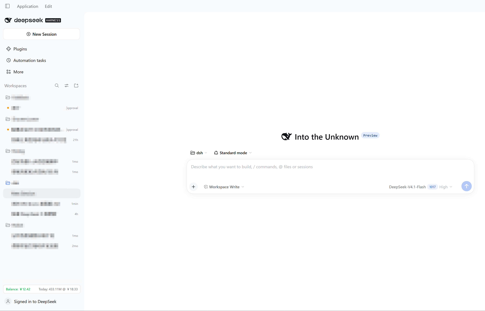
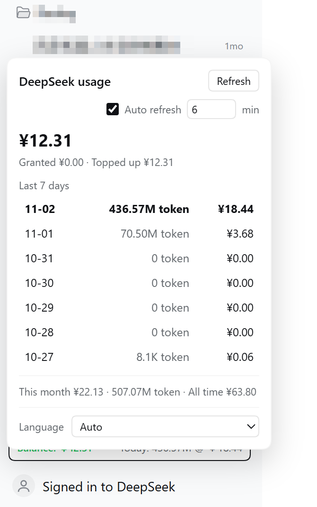

# dsh-usage-sidebar

DSH（DeepSeek Harness）のサイドバーに DeepSeek の残高・token・料金を常時表示します。

[English](README.md) | [简体中文](README.zh-CN.md) | [繁體中文](README.zh-TW.md) | [日本語](README.ja.md)

## スクリーンショット





## 機能

- **サイドバーのチップ**：左に残高（￥5 以上は緑、未満は赤）、右に今日の使用量：`Today: 119.72M @ ￥6.44`
- **ポップオーバー**：直近7日の token と料金、今日の行をハイライト、最大の日を太字、自動更新のオン/オフと間隔（既定5分）、言語切替
- **設定 → DeepSeek の残高と使用量**：残高の内訳、任意の API Key、使用統計
- **8 言語の UI**：简体中文、繁體中文、English、日本語、Français、Русский、Deutsch、Español

## 数値の出どころ

| 状態 | 残高 | token | 料金 |
| --- | --- | --- | --- |
| DeepSeek にログイン | API Key の残高（設定時） | プラットフォーム公式 | プラットフォーム公式 |
| 未ログイン | API Key の残高 | ローカルセッションログ | 非表示（ヒントあり） |

- 残高：公式 `GET https://api.deepseek.com/user/balance`（`DEEPSEEK_API_KEY` を使用）。
- ログイン時の使用量：DSH のアカウントセッション（`deepseekAccount.getPlatformSession()`）を再利用し、userToken は不要です。
- 未ログイン時の token：`$DSH_HOME/sessions`（マルチフレーム zstd）を読み、`assistant/message` の usage をローカル暦日で集計します。
- 日付境界：プラットフォームは UTC 日で集計し、Web はローカル日で表示します。プラグインはローカルの時間分布で各 UTC 日をローカル日に按分するため、合計は正確なままです。

## インストール

```powershell
# pinned commit (what the market index installs)
dsh plugin --profile <profile> add "git+https://github.com/wnk-ke/dsh-usage-sidebar.git#79a6807bc63aad49df744a3f294237008843086a"

# track main (development)
dsh plugin --profile <profile> add git+https://github.com/wnk-ke/dsh-usage-sidebar.git
```

Market index: <https://raw.githubusercontent.com/wnk-ke/dsh-usage-sidebar/main/market-index.json>

Add it in DSH: Settings → Plugins → Discover → Add index source.

## プライバシーとセキュリティ

- API Key とアカウントセッションは Host プロセス内に留まり、ブラウザには数値のみが渡ります（キーを返すルートはありません）。
- ローカルルートはループバック限定・同一オリジン検証・`x-dsh-spend` ヘッダ必須・書き込みはレート制限付きです。
- セッションログは usage の数値抽出のみに使用し、メッセージ内容は読み出しも送信もしません。
- 通信先は `api.deepseek.com` と `platform.deepseek.com` のみです。

## 互換性

- DSH `>=0.2.1-rc.5 <0.4.0`
- アカウントモードは DSH 内部の `deepseekAccount` サービスに依存する best-effort 機能で、利用できない場合はローカルログに自動で切り替わります。

## 開発

```powershell
node --check lib/index.js
node --check lib/client.js
node scripts/release.mjs --check
```
