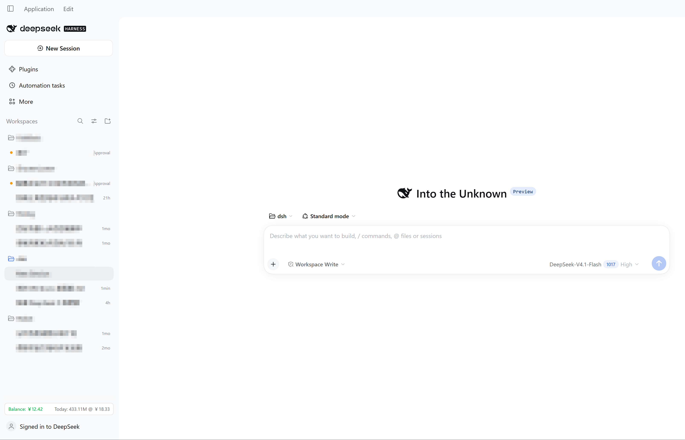
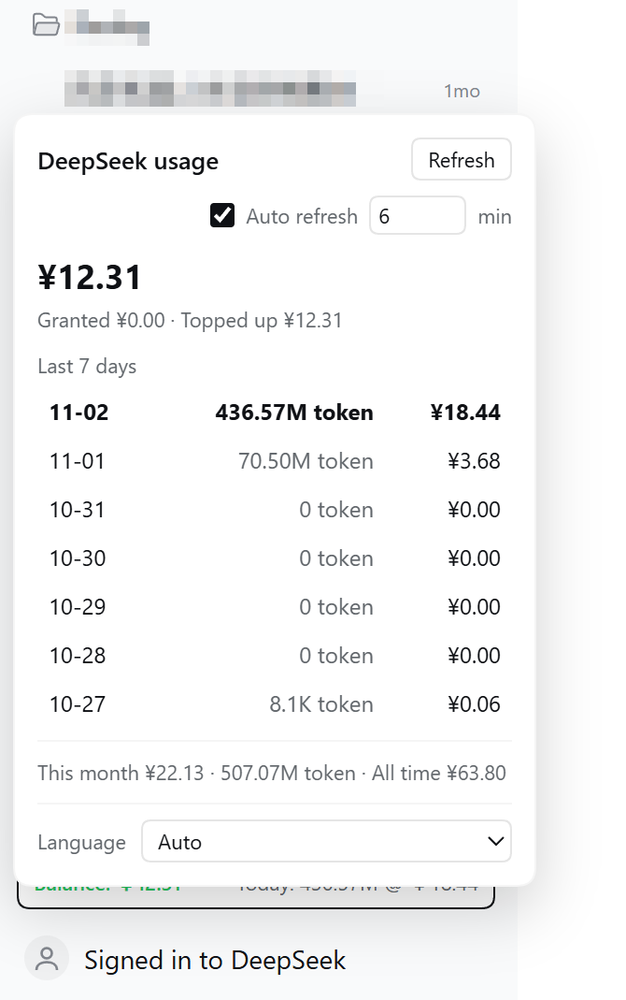

# dsh-usage-sidebar

DeepSeek balance, tokens and cost in the DSH (DeepSeek Harness) sidebar.

[English](README.md) | [简体中文](README.zh-CN.md) | [繁體中文](README.zh-TW.md) | [日本語](README.ja.md)

## Screenshots





## Features

- **Sidebar chip**: balance on the left (green ≥ ¥5, red below), today's usage on the right: `Today: 119.72M @ ¥6.44`
- **Popover**: last 7 days with tokens and cost, today's row highlighted, the heaviest day in bold, auto-refresh toggle + interval (default 5 minutes), language switch
- **Settings → DeepSeek balance and usage**: balance breakdown, optional API key, usage statistics
- **8 UI languages**: 简体中文, 繁體中文, English, 日本語, Français, Русский, Deutsch, Español

## Where the numbers come from

| State | Balance | Tokens | Cost |
| --- | --- | --- | --- |
| Signed in to DeepSeek | API-key balance (if configured) | Platform official | Platform official |
| Not signed in | API-key balance | Local session logs | Hidden, with a hint |

- Balance: official `GET https://api.deepseek.com/user/balance` with `DEEPSEEK_API_KEY`.
- Signed-in usage: reuses the DSH account session through `deepseekAccount.getPlatformSession()`; no userToken needed.
- Signed-out tokens: reads `$DSH_HOME/sessions` (multi-frame zstd) and sums `assistant/message` usage per local calendar day.
- Day boundary: the platform aggregates by UTC day, the website shows local days; the plugin splits each UTC day into local days using the local hourly distribution, so totals stay exact.

## Install

```powershell
# pinned commit (what the market index installs)
dsh plugin --profile <profile> add "git+https://github.com/wnk-ke/dsh-usage-sidebar.git#79a6807bc63aad49df744a3f294237008843086a"

# track main (development)
dsh plugin --profile <profile> add git+https://github.com/wnk-ke/dsh-usage-sidebar.git
```

Market index: <https://raw.githubusercontent.com/wnk-ke/dsh-usage-sidebar/main/market-index.json>

Add it in DSH: Settings → Plugins → Discover → Add index source.

## Privacy and security

- API keys and the account session stay in the Host process; the browser only receives numbers, no route ever returns a secret.
- Local routes accept loopback only, check same-origin, require an `x-dsh-spend` header, and rate-limit writes.
- Session logs are parsed for usage counts only; message content is never read out or transmitted.
- Requests go only to `api.deepseek.com` and `platform.deepseek.com`.

## Compatibility

- DSH `>=0.2.1-rc.5 <0.4.0`
- Account mode depends on DSH's internal `deepseekAccount` service and is best-effort; it falls back to local logs when unavailable.

## Development

```powershell
node --check lib/index.js
node --check lib/client.js
node scripts/release.mjs --check
```
