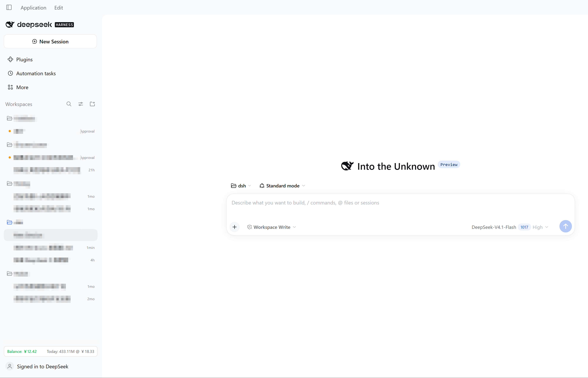
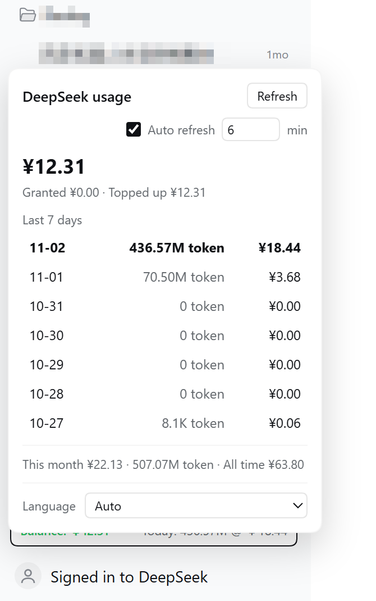

# dsh-usage-sidebar

在 DSH（DeepSeek Harness）侧边栏常驻显示 DeepSeek 余额、token 与花费。

[English](README.md) | [简体中文](README.zh-CN.md) | [繁體中文](README.zh-TW.md) | [日本語](README.ja.md)

## 截图





## 功能

- **侧边栏芯片**：左侧余额（≥￥5 绿色，<￥5 红色），右侧今日用量：`Today: 119.72M @ ￥6.44`
- **弹层**：近 7 天 token 与花费、今天那行高亮、用量最高加粗、自动刷新开关与间隔（默认 5 分钟）、语言切换
- **设置 → DeepSeek 余额与用量**：余额明细、可选 API Key、用量统计
- **8 种界面语言**：简体中文、繁體中文、English、日本語、Français、Русский、Deutsch、Español

## 数据口径

| 状态 | 余额 | token | 花费 |
| --- | --- | --- | --- |
| 已登录 DeepSeek | API Key 余额（若配置） | 平台官方 | 平台官方 |
| 未登录 | API Key 余额 | 本机会话日志 | 不显示，带提示 |

- 余额：官方 `GET https://api.deepseek.com/user/balance`，使用 `DEEPSEEK_API_KEY`。
- 已登录用量：复用 DSH 账户会话（`deepseekAccount.getPlatformSession()`），不需要 userToken。
- 未登录 token：读取 `$DSH_HOME/sessions`（多帧 zstd），按本机时区自然日汇总 `assistant/message` 的 usage。
- 日界：平台按 UTC 日聚合、网页按本地日显示，插件用本地时段分布把每个 UTC 日拆到本地日，总量保持精确。

## 安装

```powershell
# pinned commit (what the market index installs)
dsh plugin --profile <profile> add "git+https://github.com/wnk-ke/dsh-usage-sidebar.git#79a6807bc63aad49df744a3f294237008843086a"

# track main (development)
dsh plugin --profile <profile> add git+https://github.com/wnk-ke/dsh-usage-sidebar.git
```

Market index: <https://raw.githubusercontent.com/wnk-ke/dsh-usage-sidebar/main/market-index.json>

Add it in DSH: Settings → Plugins → Discover → Add index source.

## 隐私与安全

- API Key 与账户会话只留在 Host 进程；浏览器端只收到数字，任何路由都不返回密钥。
- 本地路由只接受环回地址、校验同源、要求 `x-dsh-spend` 头，写入类请求限流。
- 会话日志只用来提取 usage 数字，不读取、不上传消息内容。
- 请求只发往 `api.deepseek.com` 与 `platform.deepseek.com`。

## 兼容性

- DSH `>=0.2.1-rc.5 <0.4.0`
- 账户模式依赖 DSH 内部的 `deepseekAccount` 服务，属 best-effort，不可用时自动回退本地日志。

## 开发

```powershell
node --check lib/index.js
node --check lib/client.js
node scripts/release.mjs --check
```
