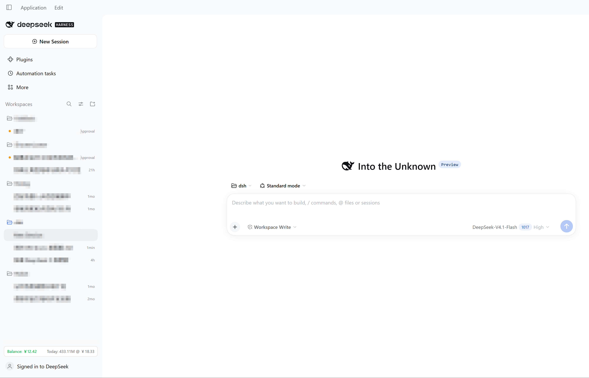
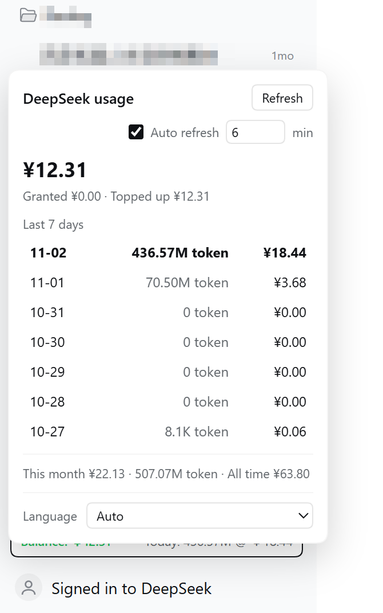

# dsh-usage-sidebar

在 DSH（DeepSeek Harness）側邊欄常駐顯示 DeepSeek 餘額、token 與花費。

[English](README.md) | [简体中文](README.zh-CN.md) | [繁體中文](README.zh-TW.md) | [日本語](README.ja.md)

## 截圖

| 側邊欄 | 彈層 |
| --- | --- |
|  |  |

## 功能

- **側邊欄晶片**：左側餘額（≥￥5 綠色，<￥5 紅色），右側今日用量：`Today: 119.72M @ ￥6.44`
- **彈層**：近 7 天 token 與花費、今天那列高亮、用量最高加粗、自動重新整理開關與間隔（預設 5 分鐘）、語言切換
- **設定 → DeepSeek 餘額與用量**：餘額明細、可選 API Key、用量統計
- **8 種介面語言**：简体中文、繁體中文、English、日本語、Français、Русский、Deutsch、Español

## 資料來源

| 狀態 | 餘額 | token | 花費 |
| --- | --- | --- | --- |
| 已登入 DeepSeek | API Key 餘額（若設定） | 平台官方 | 平台官方 |
| 未登入 | API Key 餘額 | 本機工作階段日誌 | 不顯示，附提示 |

- 餘額：官方 `GET https://api.deepseek.com/user/balance`，使用 `DEEPSEEK_API_KEY`。
- 已登入用量：重用 DSH 帳戶工作階段（`deepseekAccount.getPlatformSession()`），不需要 userToken。
- 未登入 token：讀取 `$DSH_HOME/sessions`（多幀 zstd），依本機時區自然日彙總 `assistant/message` 的 usage。
- 日界：平台以 UTC 日聚合、網頁以本地日顯示，外掛用本地時段分布把每個 UTC 日拆到本地日，總量保持精確。

## 安裝

```powershell
# pinned commit (what the market index installs)
dsh plugin --profile <profile> add "git+https://github.com/wnk-ke/dsh-usage-sidebar.git#79a6807bc63aad49df744a3f294237008843086a"

# track main (development)
dsh plugin --profile <profile> add git+https://github.com/wnk-ke/dsh-usage-sidebar.git
```

Market index: <https://raw.githubusercontent.com/wnk-ke/dsh-usage-sidebar/main/market-index.json>

Add it in DSH: Settings → Plugins → Discover → Add index source.

## 隱私與安全

- API Key 與帳戶工作階段只留在 Host 程序；瀏覽器端只收到數字，任何路由都不回傳密鑰。
- 本地路由只接受回環位址、驗證同源、要求 `x-dsh-spend` 標頭，寫入類請求限流。
- 工作階段日誌只用來萃取 usage 數字，不讀取、不上傳訊息內容。
- 請求只發往 `api.deepseek.com` 與 `platform.deepseek.com`。

## 相容性

- DSH `>=0.2.1-rc.5 <0.4.0`
- 帳戶模式依賴 DSH 內部的 `deepseekAccount` 服務，屬 best-effort，不可用時自動回退本機日誌。

## 開發

```powershell
node --check lib/index.js
node --check lib/client.js
node scripts/release.mjs --check
```
